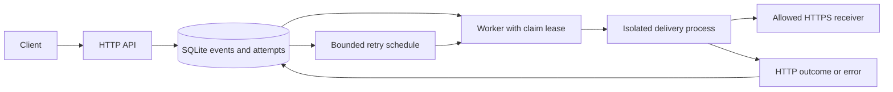

# Dispatch

A durable webhook delivery service that retains events through receiver failures, retries transient errors, and exposes what happened to each attempt.

## Run the demo

Requires Python 3.12+ and the OpenSSL executable. No Python packages or external services are needed.

```sh
python examples/demo.py
```

The demo starts a temporary local HTTPS receiver, submits an event through the HTTP API, checks idempotent enqueueing, records a 503 response, and verifies that the retry cannot run early. It then reopens the database, recreates the worker, advances the demo clock by 30 seconds, and delivers the same event successfully with a 204 response. It finishes by inspecting attempt history and queue metrics. Temporary servers, database, and certificates are cleaned up on exit.

[Recorded output](docs/demo-output.txt) comes from a successful run. This is a functional demonstration, not a performance benchmark. The demo alone redirects destination resolution to its loopback receiver and trusts its ephemeral certificate; production destination restrictions are unchanged. It does not exercise a forced process crash.

## Architecture



- Transactional enqueueing and idempotency keys prevent duplicate stored events.
- Workers claim events atomically, persist attempt outcomes, and recover expired leases with stale-completion checks.
- Transient failures use capped exponential backoff and a total attempt limit.
- Delivery revalidates allowed origins and public DNS results, pins the connection address, verifies TLS hostnames, and refuses redirects.
- Optional [HMAC-SHA256 signatures](docs/signatures.md) authenticate the raw body, event ID, and attempt timestamp.
- Child-process deadlines bound delivery execution. JSON logs, delivery history, and queue metrics expose outcomes.

SQLite provides a compact local deployment with serialized writes. Delivery is at least once: timeouts and lease recovery can overlap a receiver's earlier acceptance, so receivers must deduplicate the stable `X-Dispatch-Event-ID`. The API binds to loopback and is currently unauthenticated. Public deployment and production usage are not established.

## Verify and operate

```sh
python -m unittest discover -s tests -v
```

[Operations reference](docs/operations.md) covers API routes, worker commands, timeouts, retries, recovery limits, metrics, and structured logs. Tests include a real local HTTPS receiver, certificate rejection, DNS checks, concurrency, injected storage failures, and retry persistence.

[Local delivery measurements](docs/benchmarks.md) include repeatable baseline/failure commands, raw observations, timing definitions, and limitations.

[Build and install a wheel](docs/installation.md) to run `dispatch-api` and `dispatch-worker` outside the checkout. CI checks isolated installation on Windows and Linux.
